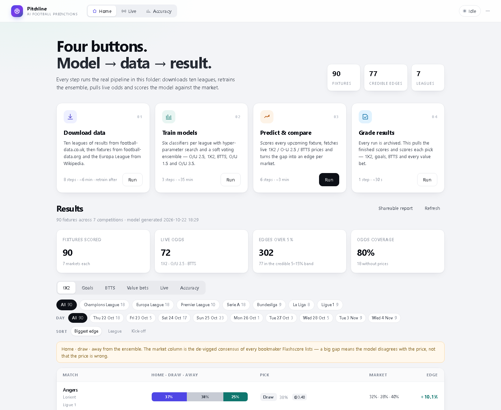
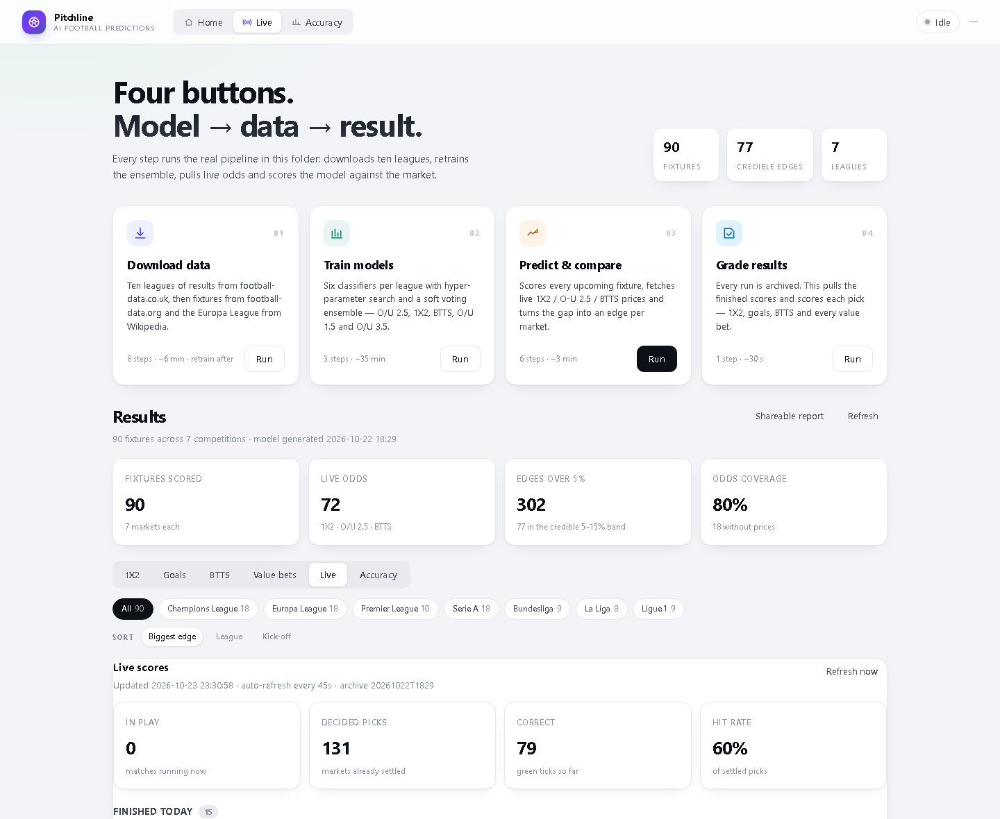
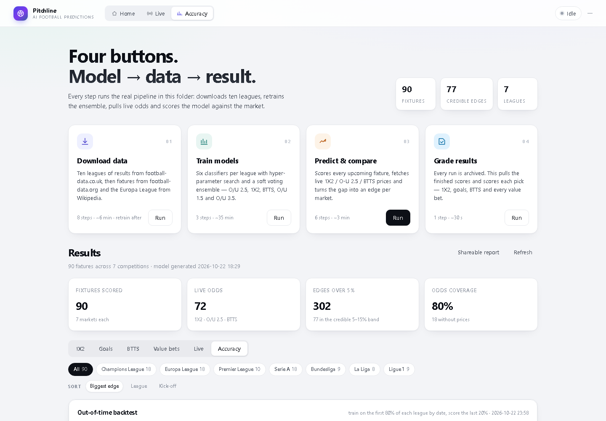

# Pitchline

**AI football predictions that grade themselves.**

Most prediction projects show you a model. Pitchline shows you the model's record — every pick is
archived before kick-off and scored against the real result afterwards, including the ones it gets
wrong.



<p align="center">
  
  
  
  
  
</p>

---

## What it does

Pitchline trains one ensemble per competition on four seasons of match data, predicts five markets
for every upcoming fixture, compares those probabilities with the live bookmaker consensus, and
tracks its own accuracy as the matches are played.

- **Five markets per fixture** — 1X2, Over/Under 1.5, 2.5, 3.5 and Both Teams To Score.
- **Model vs market** — every pick is compared against the de-vigged bookmaker consensus, so you see
  the gap, not just a probability.
- **Self-grading** — predictions are archived, then settled at full time, and goals markets settle
  *during* the match (a 2–0 after 20 minutes already wins Over 1.5).
- **One control panel** — download, train, predict and grade from four buttons, with a live console.

## The part that matters

A prediction is only worth something if you can check it later. Pitchline writes every run to
`data/history/` before the first whistle, then scores it:

```
predict ──► archive snapshot ──► kick-off ──► live ✓/✗ ──► full-time grade
   ▲                                                              │
   └──────────────── retrain on the enlarged dataset ◄─────────────┘
```

The Accuracy tab shows two numbers side by side: what the model does on data it has never seen, and
what it actually got right on your archived picks.

## Live tracking

Goals markets do not wait for the final whistle. Once the total passes the line the Over is settled
and the Under is dead — the tick appears while the match is still running.



| Market | Settles early when | Otherwise |
| --- | --- | --- |
| Over 1.5 | total ≥ 2 | Under settles at FT |
| Over 2.5 | total ≥ 3 | Under settles at FT |
| Over 3.5 | total ≥ 4 | Under settles at FT |
| BTTS – Yes | both teams scored | BTTS – No settles at FT |
| 1X2 | — | always at FT |

## Honest accuracy

Measured out-of-time: the model is trained on the first 80% of every league by date and scored on
the last 20%, so no evaluated match was seen during training.

| Market | Out-of-time | Always-pick baseline | Lift |
| --- | ---: | ---: | ---: |
| 1X2 | 54.4% | 41.8% | **+12.6** |
| Over/Under 2.5 | 67.6% | 56.8% | **+10.8** |
| Over/Under 3.5 | 70.1% | 67.0% | +3.2 |
| BTTS | 67.1% | 57.5% | **+9.6** |
| Over/Under 1.5 | 78.7% | 78.4% | +0.3 |

"Always-pick" is the accuracy of blindly choosing the most common outcome. Over 1.5 has no lift —
that market is just the base rate and should be ignored. 1X2 and BTTS are where the signal is.



## How it works

```
football-data.co.uk  ──►  raw CSVs  ──►  preprocessing  ──►  processed features
                                                                   │
                              ┌────────────────────────────────────┘
                              ▼
                    per-league training
                    LR · KNN · SVM · RF · XGB · HGB
                              │  hyper-parameter search
                              ▼
                    soft-voting ensemble  ──►  models/*.pkl + feature manifests
                              │
                              ▼
   fixtures ──► prediction ──► live odds (Flashscore) ──► model vs market
                              │
                              ▼
                     archive ──► grade ──► accuracy
```

**Features** describe each team *before* kick-off: last-5 goals scored and conceded, last-5 over-2.5
rate, season averages, shots, closing odds. **Targets** are derived from the final score.

## Quick start

```bash
python -m venv .venv
.venv/Scripts/activate            # Windows
pip install -r requirements.txt
```

Create a `.env` with a [football-data.org](https://www.football-data.org/) key (fixtures), then:

```bat
run_panel.bat
```

or run the server directly:

```bash
python webapp/server.py           # http://127.0.0.1:8000
```

Four buttons, in order:

| Button | Runs | Time |
| --- | --- | --- |
| **Download data** | 10 leagues, 4 seasons → preprocessing → fixtures | ~6 min |
| **Train models** | 6 algorithms × 5 markets per league, then the backtest | ~35 min |
| **Predict & compare** | predictions → live odds → model vs market → archive | ~2 min |
| **Grade results** | settles archived picks against finished matches | ~30 s |

The CLI equivalents and the full pipeline notes are in [`RUNNING.md`](RUNNING.md).

## Project layout

```
scripts/            data acquisition, preprocessing, training, prediction, grading
  features.py       the single definition of the feature matrix
  teams.py          club-name matching shared by odds, grader and live tracker
webapp/             control panel (stdlib HTTP server, no framework)
data/history/       archived predictions, graded results, backtest output
models/             trained ensembles + feature manifests
flashscore_api/     odds, lineups and live scores
```

## Engineering notes

Three things worth reading before you trust a number in this repo.

**1. The models used to be 83% accurate. They were cheating.**
`train_models.py` dropped only two of the five target columns, so `BTTS`, `Over1.5` and `Over3.5` —
all derived from the same scoreline — sat in the feature matrix. The rolling features also had no
`.shift(1)`, so each row contained its own match. Fixing both dropped cross-validation from 83% to a
believable 63–70%, and the probabilities from a pinned 99% to a real distribution.

**2. Two sources, one fixture.**
Flashscore and football-data spell clubs differently — `OFI` vs `OFI Crete`, `St. Gilloise` vs
`Royale Union SG`, `Plzeň` vs `Plzen`. `teams.py` is now the only matcher: accents stripped with
NFKD, aliases expanded, and *both* sides of a fixture must clear a similarity threshold. The loose
version matched `Galatasaray vs Stuttgart` to `Paderborn vs Stuttgart` and produced a 72% "edge".

**3. A probability is not a price.**
Market probabilities are de-vigged per bookmaker and then averaged, so a book that quotes only two
of three outcomes cannot leave a three-way market summing to 91%. The price shown is the best
available across every bookmaker — the same number the edge is measured against.

## Roadmap

- [ ] Probability calibration (isotonic on a holdout season) — the current output is uncalibrated
- [ ] Player availability features: lineups and injuries, currently prototyped for the Premier League
- [ ] Extra-league normaliser so more Europa League clubs have history
- [ ] Scheduled retraining (download → train → predict → grade, unattended)

## Credits

(BSD 3-Clause). Data from [football-data.co.uk](https://www.football-data.co.uk/),
[football-data.org](https://www.football-data.org/) and Flashscore.

## Disclaimer

Research project, not betting advice. Probabilities are uncalibrated, and a model that beats the
baseline is not the same as a model that beats the market. Never stake money on this.
